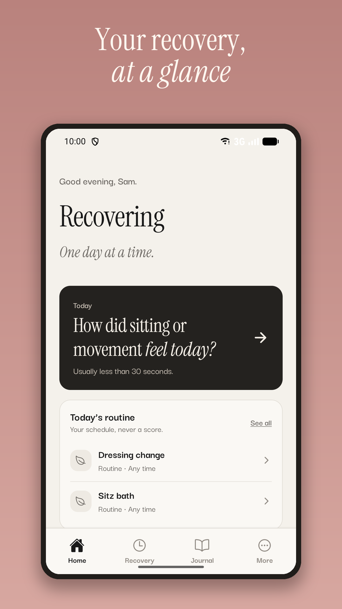
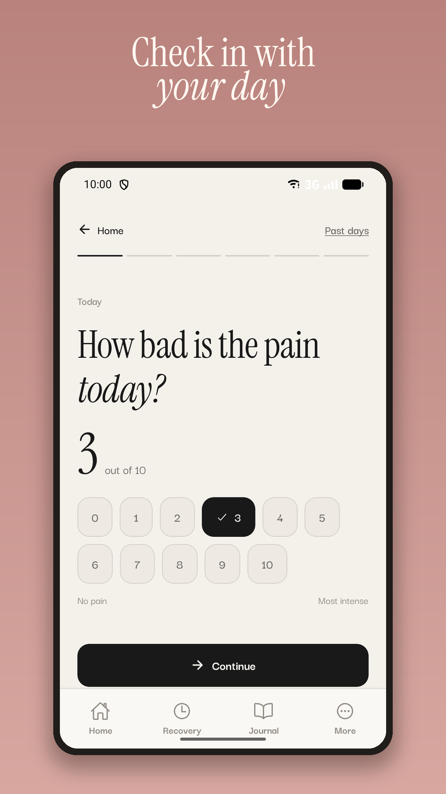
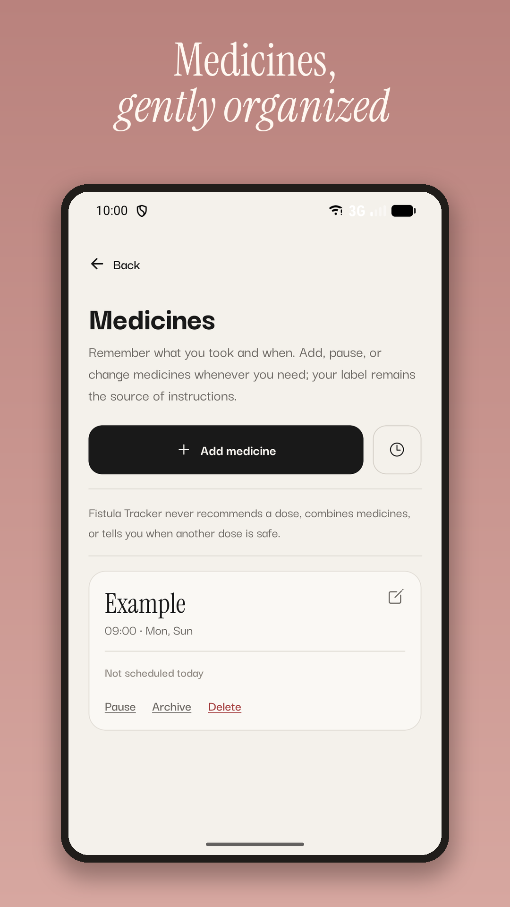
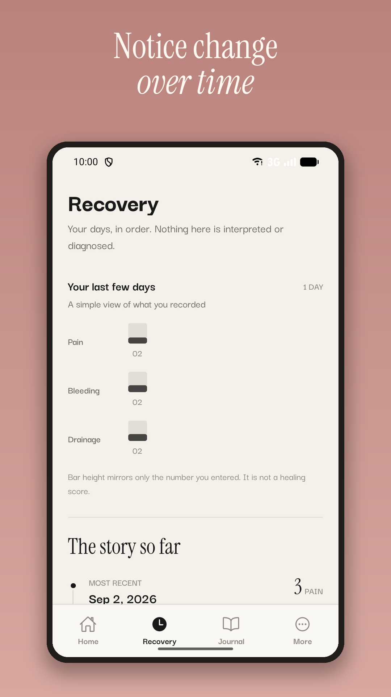
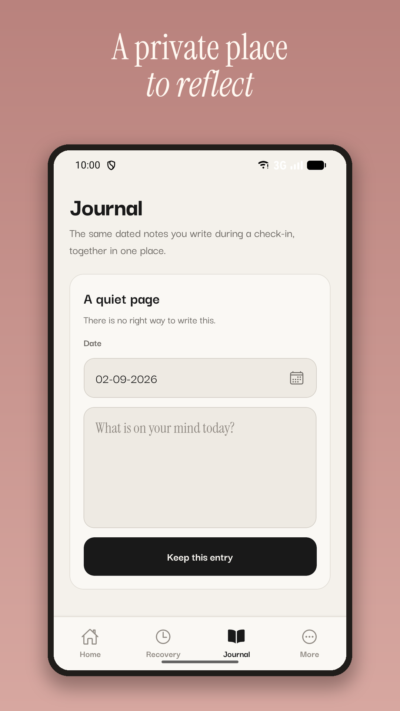
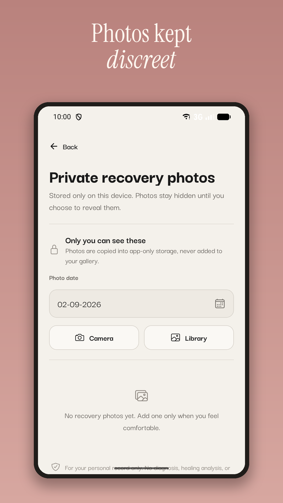

# Fistula Tracker


An Android-first, local-first companion for keeping the practical parts of anal fistula recovery organized in one private place.

[**Download the latest Android APK**](https://github.com/sidbfz/fistula-tracker/releases/latest/download/Fistula-Tracker-1.0.2.apk)

> The Google Play production listing is still pending, so this build is distributed directly through GitHub. Android may ask you to allow installation from your browser or Files app. The APK is release-signed; only download it from this repository's Releases page.

## Video demo

[](https://www.youtube.com/watch?v=yNceIYF8Y7w)

[**Watch the demo on YouTube**](https://www.youtube.com/watch?v=yNceIYF8Y7w)

## What it helps with

- Daily recovery check-ins and an editable recovery timeline
- Medicine schedules, local reminders, and Taken/Skipped/Postponed history
- A private wound-photo timeline stored inside the app's local storage
- A recovery journal and a personal “When I recover” list
- A customizable routine and recovery essentials checklist
- Optional device authentication and complete local-data deletion
- Every feature is free, with no purchases or subscriptions in version 1.0.3 onward
- Optional email feedback and clear app version details

## Screenshots

<p align="center">
  
  
  
</p>
<p align="center">
  
  
  
</p>

## Privacy by design

- No account, backend, cloud sync, remote health storage, or health-data analytics
- Structured recovery data is stored in the on-device `recovery.db` SQLite database
- Wound photos are copied into the app-private document directory
- Local device notifications are used for reminders; no remote push token is requested
- Settings can permanently delete structured data, reminders, and private photos
- No purchase SDK or automatic purchase-data collection in version 1.0.3 onward
- Feedback opens an editable email draft; no recovery records, photos, logs or device identifiers are attached automatically

Read the complete [privacy policy](PRIVACY_POLICY.md).

## Important medical notice

Fistula Tracker is a personal organization tool, not a diagnostic or medical-advice service. It does not analyze photos, detect infection, score healing, decide whether recovery is normal, recommend treatment, calculate a safe next dose, or replace advice from a qualified healthcare professional.

## Built with

- Expo 54 and React Native
- TypeScript and Expo Router
- Expo SQLite for on-device structured data
- Expo Notifications for local reminders

## Run locally

Requirements: Node.js 24 or newer (the regression tests use Node's SQLite API), npm, and an Android development environment.

```bash
npm install
npm run android
```

Expo Go can exercise most flows. Use a native Android development or release build to verify device authentication and local reminders.

## Environment setup

No API keys or remote services are required. Never commit local environment files or signing credentials.

The demo video and the currently published GitHub APK show the earlier 1.0.2 version. Version 1.0.3 removes its optional supporter purchase. See the privacy policy for how earlier purchase records are handled.

## Verification

```bash
npm run verify
```

The verification command runs the automated tests, TypeScript checks, linting, Expo dependency alignment checks, and Expo Doctor.
